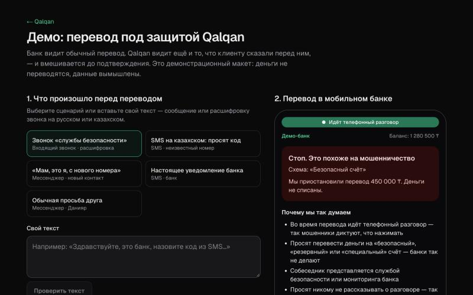
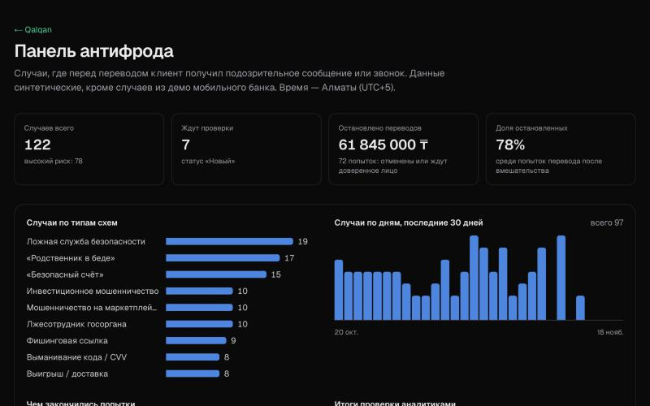
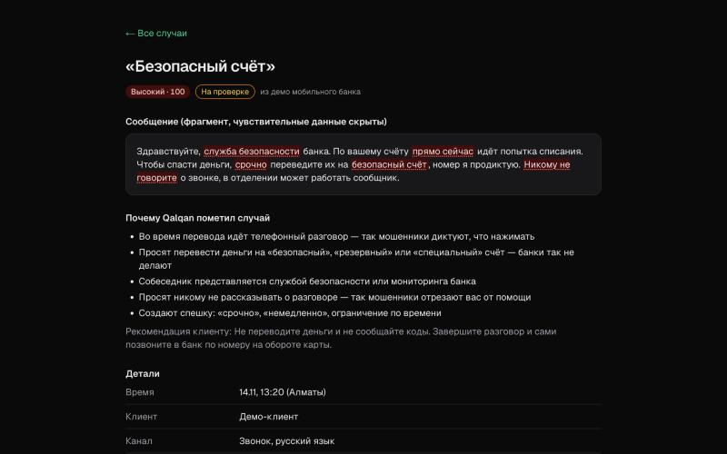
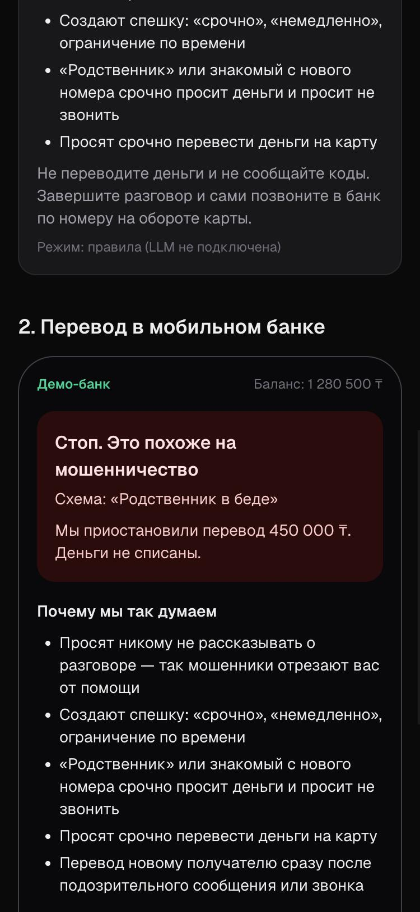
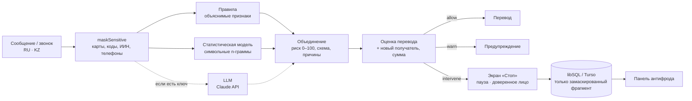

# Qalqan — щит от социальной инженерии

> *Қалқан* — «щит» по-казахски.
> V Региональный ITU Hackathon-2026 · FinTech-кейс Банка ЦентрКредит
> «Инновации в банкинге и кибербезопасности».

**Демо:** https://qalqan-one.vercel.app · [мобильный банк](https://qalqan-one.vercel.app/bank) ·
[панель антифрода](https://qalqan-one.vercel.app/dashboard)



## Проблема

Самые болезненные схемы мошенничества сегодня — социальная инженерия: звонок
«службы безопасности банка», «безопасный счёт», «следователь», «родственник в беде»,
фишинговые ссылки. Клиента убеждают **самого** перевести деньги или назвать код.

Для классического антифрода это штатная операция: правильное устройство, правильный
пароль, подтверждение клиентом. Банк видит перевод — но не видит, *что клиенту сказали
за минуту до него*.

## Решение

Qalqan добавляет банку слой защиты **до** перевода:

1. **Анализ сообщений и звонков** на русском и казахском (SMS, мессенджеры, расшифровки
   звонков): риск-скор 0–100, тип схемы, понятное объяснение и рекомендация.
2. **Вмешательство перед переводом.** Перевод оценивается вместе с контекстом: недавнее
   подозрительное сообщение, новый получатель, сумма. При высоком риске — экран
   «Стоп» с причинами простыми словами, пауза 20 секунд, подтверждение через
   доверенное лицо или отмена. Деньги не списываются.
3. **Панель антифрода** для сотрудников банка: помеченные случаи, статистика по типам
   схем и исходам, сумма остановленных переводов, карточка случая и решение аналитика.

**Аудитория:** клиенты банка — прежде всего пожилые и неопытные в цифровых сервисах — и
антифрод-подразделение банка.

## Попробуйте за минуту

1. Откройте [демо мобильного банка](https://qalqan-one.vercel.app/bank).
2. Выберите сценарий **«Звонок „службы безопасности“»** или **«SMS на казахском: просят код»**.
3. Нажмите **«Перевести 450 000 ₸»** новому получателю — появится экран вмешательства.
4. Нажмите **«Отменить перевод»** и откройте [панель антифрода](https://qalqan-one.vercel.app/dashboard):
   ваш случай — первая строка с пометкой «демо».
5. Для сравнения выберите **«Настоящее уведомление банка»** или **«Обычная просьба друга»** —
   перевод пройдёт без вмешательства.

| Панель антифрода | Карточка случая | Телефон |
|---|---|---|
|  |  |  |

## Как это работает



- **Правила** (`src/lib/detector/rules.ts`) — признаки социальной инженерии на русском,
  казахском и в транслите: просьба назвать код, «безопасный счёт», удалённый доступ
  (AnyDesk), представление полицией или службой безопасности, секретность, спешка,
  поддельные ссылки, «родственник с нового номера» и др. Защитные признаки («никому не
  сообщайте код», «позвоните по номеру на обороте карты») не дают принять настоящие
  уведомления банка за мошенничество.
- **Статистическая модель** (`src/lib/detector/model.ts`) — логистическая регрессия на
  символьных n-граммах: устойчива к опечаткам, транслиту и казахским окончаниям. Обучается
  `npm run train` на 444 размеченных сообщениях (два автора), работает локально и бесплатно. Поднимает
  риск до вмешательства только вместе с хотя бы одним признаком правил.
- **LLM-слой** (`src/lib/detector/llm.ts`) — Claude API со структурированным ответом.
  Получает только замаскированный текст; любой сбой — автоматический фолбэк на правила.
  Однозначный признак модель «отменить» не может — защита от текста, пытающегося ею
  управлять. *В демо LLM не подключена (платный API): анализ выполняют правила и модель.*
- **Оценка перевода** (`src/lib/transfer/risk.ts`) — решение `allow / warn / intervene`.
  Риск считает сервер; клиент не может прислать «нужный» скор.

### API

```bash
curl -X POST https://qalqan-one.vercel.app/api/analyze \
  -H 'content-type: application/json' \
  -d '{"text":"Здравствуйте, служба безопасности банка. Назовите код из SMS."}'
```

```json
{
  "riskScore": 95,
  "scamType": "fake_security_service",
  "reasons": ["Просят сообщить код из SMS, CVV или данные карты — их не спрашивает никто, включая банк", "…"],
  "recommendation": "Не переводите деньги и не сообщайте коды. …",
  "mode": "rules"
}
```

| Маршрут | Назначение |
|---|---|
| `POST /api/analyze` | анализ текста `{ text, lang? }` |
| `POST /api/transfer/assess` | оценка перевода `{ amount, newRecipient, messageText? }` |
| `POST /api/cases` | запись исхода для панели (риск пересчитывается на сервере) |
| `GET /api/health` | состояние базы для диагностики (без адреса и токенов) |

## Качество детектора — честно

Подробно — [docs/metrics.md](docs/metrics.md). Замер на **независимых наборах**, которые писал
другой автор и на которых ничего не обучалось:

| Набор | Версия | Вмешательство: поймано / ложные | Хотя бы предупреждение: поймано / ложные |
|---|---|---:|---:|
| `challenge-4` (самый чистый) | только правила | 45% / 15% | — |
| `challenge-4` | **правила + модель** | **75% / 15%** | **100% / 30%** |
| `challenge-2` | только правила | 10% / 5% | — |
| `challenge-2` | **правила + модель** | **45% / 5%** | **95% / 30%** |

Правила надёжно ловят известные формулировки, но перефразированные схемы пропускают.
Статистическая модель на символьных n-граммах (бесплатно, без внешних API) ловит
перефразировки, а правило двух сигналов не даёт ей одной блокировать переводы: без
подтверждения правилами — только предупреждение. Казахский пока слабее русского — данных
меньше. Мы показываем эти цифры, а не 100% на собственных данных.

## Приватность и безопасность

- Номера карт, CVV, коды из SMS, телефоны, ИИН и IBAN **не хранятся**: перед записью в
  базу и перед отправкой в LLM текст проходит маскирование (`src/lib/privacy.ts`). В схеме
  базы нет полей для платёжных данных; клиент — псевдоним. Реквизиты получателя на
  сервер не передаются вовсе.
- Маскирование эвристическое и не даёт полной гарантии, поэтому в базу пишется только
  короткий фрагмент, а в LLM — только замаскированный текст.
- Тексты запросов не логируются. Все данные в репозитории синтетические.
- Ограничение частоты запросов, лимит размера тела, проверка входа (zod), заголовки
  безопасности (HSTS, `X-Frame-Options`, `X-Content-Type-Options` и др.), пароль на панель
  (`QALQAN_DASHBOARD_PASSWORD`). Секреты — только в переменных окружения.

## Стек

TypeScript · Next.js 16 (App Router) · React 19 · Tailwind CSS 4 · libSQL / Turso (SQLite) ·
Zod · Claude API (опционально) · Vitest (453 теста) · Vercel.

## Структура репозитория

```
src/app/              страницы и API (Next.js App Router)
src/lib/detector/     детектор: правила, LLM, объединение
src/lib/transfer/     оценка перевода
src/lib/privacy.ts    маскирование карт, телефонов, ИИН, IBAN, кодов
src/lib/db/           клиент libSQL, схема и миграции, диагностика
src/lib/dashboard/    запросы панели, доступ
src/components/       интерфейс демо банка и панели
data/dataset/         размеченные наборы RU/KZ (см. data/README.md)
scripts/              seed базы, оценка качества, проверка кода ревьюером
tests/                тесты (Vitest)
docs/                 метрики, скриншоты, материалы для сдачи
```

## Запуск

Нужен Node.js 20.9+.

```bash
npm install
cp .env.example .env.local   # всё необязательно: без ключей работают правила и локальная SQLite
npm run db:seed              # синтетические данные в data/qalqan.db
npm run dev                  # http://localhost:3000
```

Проверки: `npm run check` (линтер, типы, тесты, проверка набора), оценка качества: `npm run eval`.

## Деплой (Vercel)

1. Импортируйте репозиторий на [vercel.com/new](https://vercel.com/new) — настройки сборки
   определяются автоматически.
2. Переменные окружения (все необязательны):

| Переменная | Зачем |
|---|---|
| `DATABASE_URL`, `DATABASE_AUTH_TOKEN` | постоянная база Turso (`libsql://…`). Без них база живёт в `/tmp` функции и может сбрасываться |
| `QALQAN_DASHBOARD_PASSWORD` | пароль на панель антифрода (HTTP Basic). Без него панель открыта |
| `ANTHROPIC_API_KEY` | включает LLM-слой. Без него работают только правила |
| `QALQAN_AUTO_SEED` | `0` — не заполнять пустую базу синтетикой |

Пустая база создаётся и заполняется синтетикой автоматически при первом запросе.
Диагностика: `GET /api/health`.

## Ограничения

- LLM-слой реализован и протестирован на заглушках, но в демо не подключён (платный API):
  анализ выполняют правила, качество на новых формулировках низкое (см. выше).
- Распознавание речи не входит в MVP: звонки анализируются по готовой расшифровке.
- Интеграции с реальным банком нет; мобильный банк — демонстрационный макет,
  «доверенное лицо» имитируется.
- Тестовые наборы синтетические и небольшие; казахские тексты требуют проверки носителем.
- Панель антифрода в демо открыта для жюри; учётные записи сотрудников и журнал действий —
  вне объёма хакатона.

## Что дальше

1. Подключить LLM и измерить гибрид на независимом наборе; собрать реальные
   обезличенные примеры вместе с банком.
2. Распознавание речи для звонков (RU/KZ) прямо в приложении банка — с согласия клиента.
3. Сигналы устройства: идущий звонок во время перевода, удалённый доступ, новое устройство.
4. Обратная связь от аналитиков (подтверждено / ложное срабатывание) — в настройку правил.

## Как мы работали

Команда — 3 человека, каждый со своим ИИ-агентом ([CONTRIBUTING.md](CONTRIBUTING.md)).
Ведущий разработчик (лид + Claude Code) писал ядро; **каждый этап проверял независимый
ревьюер Codex** в изолированной копии репозитория: запускал проверки, писал тесты,
искал уязвимости и составлял отчёт (до 3 циклов «исправление → перепроверка» на этап).
Ревьюер нашёл, например, обходы маскирования, подмену `X-Forwarded-For` для обхода
лимита, гонки в интерфейсе и несовместимость миграции с Turso — всё исправлено и
закреплено регрессионными тестами. Процесс описан в [AGENTS.md](AGENTS.md) и
[CLAUDE.md](CLAUDE.md), скрипт — `scripts/codex-review.sh`.
